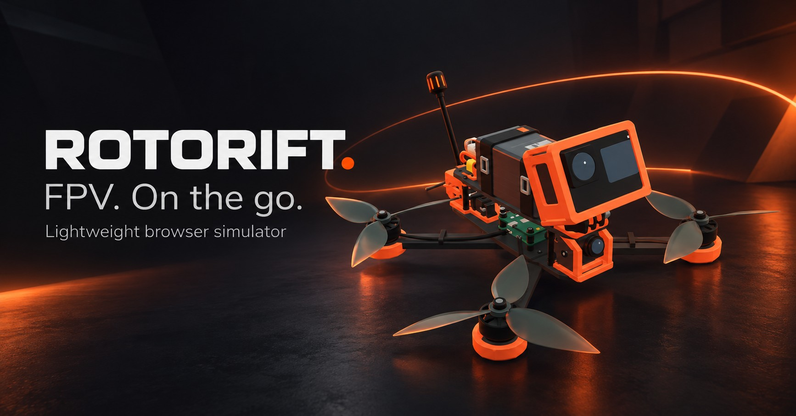

# Rotorift



**FPV. On the go. Desktop or phone.**

A lightweight FPV drone simulator that runs in your browser, with low-poly worlds,
detailed procedural aircraft, Three.js rendering and Rapier rigid-body physics.
Fly with a compatible USB radio or controller, or try it with a keyboard.
Node.js/WebSocket multiplayer and MySQL/MariaDB leaderboards support online sessions.

**[Play Rotorift](https://fpv.levente.net/)** · **[Explore the showcase](https://szabolevi98.github.io/rotorift/)** · **[Deployment guide](DEPLOY.md)**

Rotorift is a playable prototype. The six drone configurations have automated
flight measurements, but matching specific real aircraft requires further tuning
against flight logs. Hardware compatibility also depends on the radio, firmware,
operating system and browser.

## Getting started

Requirements: **Node.js 22 or newer** and a **WebGL 2 browser**. MySQL or MariaDB
is needed to save online records; flying remains available if the database is
unavailable at startup.

```sh
npm ci
cp .env.example .env
npm start
```

In PowerShell, replace `cp .env.example .env` with `Copy-Item .env.example .env`.
Copy the environment file only during initial setup, then edit it for your installation.

Open **http://localhost:3015/**. The Node server serves the game, API and WebSocket
connection. XAMPP can supply MariaDB/MySQL; Apache can also serve the standalone
showcase at `http://localhost/rotorift/showcase/`.

The default local database settings are `rotorift`, user `root`, an empty password,
and `127.0.0.1:3306`. The server creates the database and tables if the configured
user has permission. Change these settings in `.env` for your environment.

| Command | Purpose |
| --- | --- |
| `npm run dev` | Start the server with automatic restarts during development |
| `npm test` | Run the test suite |
| `npm run physics:measure` | Write flight measurements to `docs/flight-measurements.json` |
| `npm run maps:build` | Rebuild path surfaces, curbs and prepared collision assets |
| `npm run collisions:build` | Rebuild collision assets only |
| `npm run showcase:build` | Rebuild the standalone drone showcase and map/race viewer |

Rebuild maps after changing paths or site layouts. Surface clipping happens at
build time; the game does not load the polygon-clipping dependency. The showcase
build also prepares these surfaces before packaging its viewer.

Database tests create and remove a separate `rotorift_test_<id>` database without
changing game records. That test is skipped when MariaDB/MySQL is unavailable.

## Aircraft and maps

Fleet snapshot: **2026-10-20 — six drones, three airplanes and five maps**.
The Apex Circuit expansion is included in the 2026-10-20 release.
Counts describe that date and may grow; the runtime catalog comes from
`data/drones/`, `data/airplanes/` and `data/maps/`. See the
[current implementation summary](docs/prototype.md) for the latest documented scope.

| Aircraft | Class | Battery |
| --- | --- | --- |
| Rift 65 | 65 mm tinywhoop | 1S / 300 mAh |
| Rift 75 | 75-class whoop, 80.8 mm motor diagonal | 1S / 580 mAh |
| Rift C3 | 3-inch cinewhoop | 4S / 720 mAh |
| Rift X35 | 3.5-inch freestyle | 4S / 650 mAh |
| Rift X5 | 5-inch freestyle | 6S / 1300 mAh |
| Rift R5 | 5-inch racing, upper fin / underslung pack | 6S / 1050 mAh |
| Rift Aero 40 · experimental | 400 mm P-51D-inspired micro warbird | 1S / 400 mAh |
| Rift Aero 75 · experimental | 750 mm pusher parkflyer | 2S / 650 mAh |
| Rift Aero 150 · experimental | 1.5 m high-wing RC trainer | 3S / 3200 mAh |

The [Rift R5](docs/rift-r5.md) adds a compact 5-inch / 6S racing airframe, a top shark fin and an underslung pack. It is lighter and accelerates faster than X5; the current calm, nominal-voltage measurement gives about 218 km/h sustainable level cruise.

The [Rift Aero 150](docs/rift-t15.md) introduces separate fixed-wing aerodynamics:
lift/drag, stall, airflow-dependent elevator/aileron/rudder control, gliding and
single-motor propulsion. All airplanes offer Manual and Stabilized modes.
Stabilized uses the control surfaces to return pitch and bank to level when the
right stick is released, with 20° pitch and 35° bank demands. Throttle stays
manual; there is no altitude hold, stall prevention or automatic landing. Press
**M**, use the HUD mode button or assign a radio action to switch in flight.
Switching invalidates the current timed lap; records/ghosts retain their mode.
The Aero 150 supports local/online free flight, mixed drone/airplane rooms
for up to eight pilots, eight airplane circuits across Grove, Concrete Yard, Skyline and the local Apex Circuit,
records and pose ghosts.
Choose an airborne practice start, or a ground start on the Grove south promenade
in free flight. It has separate control travel/expo, animated surfaces, wingtip
and landing-gear collisions, wind and battery simulation. Explore the same model
in the showcase and export it as GLB. Handling remains an experimental estimate;
it is not a calibrated real-aircraft replica. Drone-only courses and solo Playground
flights are excluded for the trainer; mixed online free flight allows any aircraft on any map.

The [Rift Aero 75](docs/rift-s75.md) adds a smaller 750 mm, 230 g foam-style
parkflyer with a raised brushless pusher, rounded pod and nose camera. Its own
2S configuration, airframe colliders, launch height and acoustic profile share
the fixed-wing solver and existing airplane circuits. It also joins mixed rooms
with every drone and the Aero 150.

The [Rift X35](docs/rift-x35.md) is a compact 215 g carbon-frame aircraft with a
top-mounted battery and no action camera. Its measured simulation hover throttle
is 28.6%, with a near-level top speed of 153.6 km/h.

The [Rift Aero 40](docs/rift-a40.md) is a 400 mm / 1S, 62 g micro warbird inspired by the P-51D: a tractor propeller, flush curved canopy, low tapered wing, taildragger gear and animated surfaces. It uses the same fixed-wing physics, race routes and mixed multiplayer support.

- **Grove:** a rolling 700 × 700 m park with a fly-through central pavilion,
  connected upper gallery and stairs, paths, tree groups and open freestyle space.
  Two lakes, an animated fountain, a boathouse, pier, bridge, café, covered walkway
  and hilltop pavilion provide varied lines. The southern sports area includes
  an open clubhouse, terrace, basketball court and covered parking.
- **Concrete Yard:** a large unfinished construction site with open structural
  frames, cranes, earthworks, construction vehicles, materials and a hangar.
- **Playground:** an 84 × 84 m practice area for the 65/75 whoops, with a climbing
  fort, swings, a cube climber, timber tunnel and playhouse.
- **Skyline:** a 600 × 600 m city district with brick buildings, stepped skyscrapers
  and a central tower reaching 244 m. Fly through its covered podium passage, elevated skywalk,
  five-level parking garage and alleys. Rooftop water tanks, equipment, fire escapes,
  parked vehicles, street furniture and a fountain square complete the district.
  Three drone routes explore the street canyons, garage, skywalk and rooftops;
  two airplane circuits add rooftop sightseeing and low boulevard flying.

- **Apex Circuit:** an 800 × 800 m motorsport park with a 2.21 km technical asphalt track,
  open pit garages, three grandstands, control tower, paddock and fly-under bridge.
  Eight GT cars share deterministic, server-timed traffic in multiplayer. Two
  drone and two airplane routes are included. See [Apex Circuit](docs/apex-circuit.md).

Map names are localized. Stable internal IDs such as `liget`, `betonudvar` and
`jatszoter` remain unchanged for saved routes, rooms and records.

Bare terrain continues outside the fences without scenery objects. Leaving the
map starts a **one-minute return countdown**; returning cancels it, while expiry
resets the aircraft to launch. Distant terrain fills the horizon independently of
nearby scenery and collision loading, with a 12 km view distance.

Explore maps and race routes in the [showcase](https://szabolevi98.github.io/rotorift/).
The old `/map-preview.html` address redirects to its map tab.

## Flying and controls

- **Acro, Angle and Horizon**, switchable during flight.
- **Chase, FPV with the aircraft visible, and clean FPV** views.
- Airplanes also offer **Ground pilot** view in the **V** / HUD camera cycle.
  Each entry places a stationary observer at eye height on the terrain or usable
  roof beneath the airplane. Nearby safe footing is used around edges, props and
  water. The camera smoothly pans and tilts to follow the airplane without banking.
  Zoom with the mouse wheel or the on-screen **− / +** controls. Switch away and
  back to choose a new pilot point. FPV video effects and horizon stay off in this view.
- Camera angle and field of view settings for each aircraft.
- Optional artificial horizon and analog video effects, including noise,
  color bleed and brief line glitches, available in FPV for solo and online flying.
- Optional battery simulation, individual propeller damage, propwash and wind. Airplanes also support optional two-blade propeller damage, with thrust loss, visible blade deformation and a single-prop HUD. Their optional [propeller slipstream](docs/airplane-slipstream.md) increases control authority only on tail surfaces reached by the wake.
- Turtle mode for recovering an overturned aircraft.
- Local freestyle and time trials, online freestyle, three-lap races and
  server-tracked solo time trials.
- English, Hungarian, German, French and Spanish interfaces.

### Keyboard

| Default key | Action |
| --- | --- |
| Space | Arm / disarm |
| W / S | Increase / decrease throttle; throttle stays at the selected value |
| Arrow keys | Pitch / roll |
| A / D | Yaw |
| H | Set estimated hover throttle; this is not altitude hold |
| Shift | Reduce stick deflection for finer control |
| R | Reset aircraft |
| V | Cycle camera views |
| M | Cycle flight modes |
| T | Toggle turtle mode while disarmed |
| Esc | Pause menu / resume |

All default bindings can be changed in settings. Arming requires low throttle.

### Radios, controllers and mobile

A radio exposed as a USB joystick is the primary input, with automatic keyboard
fallback on desktop and touch sticks on mobile when no controller is detected.
Settings include channel mapping, inversion, deadband, stick centers
and a six-second endpoint calibration. A browser may require a stick movement
before exposing the connected device.

Pitch inversion defaults to **off for raw FPV radios** and **on for standard
gamepads**, so their different USB axis conventions can produce the same forward
stick / nose-down control. Custom inversion and calibration settings are preserved.

RadioMaster/EdgeTX devices have automatic profiles and device priority. A
four-movement stick detector can learn custom mappings; desktop and Android
profiles are saved separately. See the [radio setup guide](docs/radio-setup.md)
for Android USB channel issues and cases that need a separate simulator radio model.

An animated Mode 2 3D radio guide shows stick centers, axis movement and calibration
endpoints, including live stick movement from the connected radio. Small screens
keep the text instructions and hide the 3D illustration.

Mobile play uses landscape orientation. Launching or resuming a flight requests
fullscreen, and returning to the main menu exits it where supported by the browser.
A manual fullscreen toggle remains available. Loading screens show model download
progress and preparation; switching aircraft after startup uses an overlay.

On-screen **ARM/DISARM**, **Reset**, camera, flight-mode and menu buttons are also
available on phones. Without a detected controller, the HUD becomes two large
Mode 2 touch sticks in the lower corners. Left: throttle/yaw; right: pitch/roll.
Throttle holds on release; the other axes recenter. Pausing, resetting or an
interrupted touch clears the input. Connecting a controller restores the compact
stick display and uses the radio's calibrated axes.

Each drone has a distinct procedural motor sound: four separately driven rotor
voices, blade harmonics, filtered airflow and duct resonance. Sound follows motor
mixing, damaged propellers and optional propwash, with no downloaded samples.
See [drone audio](docs/drone-audio.md) for implementation and tuning limits.

**Auto arm** is enabled by default under **Settings → Controls**. After launch,
reset or resume, lower throttle to zero and then raise it to arm. Keyboard throttle
starts at zero, so the first throttle increase arms the aircraft. Manual disarm
takes priority until reset or resume. This personal setting also works in multiplayer.

Under **Settings → Controls → Radio / controller actions**, choose **Assign**, then
press a button or move an unused AUX channel to its endpoint. A button toggles ARM;
an AUX switch arms when on and disarms when off. An already-active switch does not
arm automatically on connection or resume. Flight stick channels cannot also be
assigned as AUX actions, and bindings are saved per device.

### Rates and settings

Actual Rates use **Center Sensitivity / Max Rate / Expo** for each axis, with defaults
of **70 / 670 / 0**. Save rates per aircraft, copy them to another drone or apply them
to all drones. Radio profiles, language, camera settings, bindings and rates stay
in the browser.

Settings have four tabs: **Controls**, **Radio & calibration**, **Rates**, and
**Video & audio**. The main menu and pause menu share the same settings interface;
switching tabs preserves edited values. See [settings-menu.md](docs/settings-menu.md).

## Multiplayer and records

Singleplayer and Multiplayer have separate menu pages. Multiplayer provides a room
list, joining by code and room creation. Open rooms refresh every five seconds.
Both launch pages retain the 3D aircraft preview and shared aircraft/map selectors.
Simulation options remain visible; in a room, only the host can change them before
launch. They are locked for guests and after the session starts.

Rooms support **up to eight pilots**; online solo time trials are single-player.
In **Free flight**, each pilot chooses their own aircraft and flight mode in the
lobby: tinywhoops, freestyle drones and the trainer can fly together. Planes choose
an airborne start or a ground start where available. Public free-flight rooms stay
joinable during flight. Reconnect and restart preserve each pilot’s aircraft.
Race and verified time-trial rooms retain one common aircraft.

Pilots mark themselves ready, and the host starts a three-second countdown.
The live scoreboard uses server-tracked laps and times. Race finishers are ranked
by total time. Opening the menu pauses only your aircraft while other pilots continue.

Gate 1 starts a lap. Pass every gate in order and in the correct direction, then
cross gate 1 again to finish it. Reset starts a new attempt; an interruption or
invalid state invalidates the current lap. Records are separated by map, route
ID/version, aircraft/configuration hash and simulation rules. The records page
combines flight modes by default, shows each entry's mode, and offers an optional
mode filter. Stored laps retain their mode so existing records and ghost selection
remain compatible.

Checkpoint deltas compare elapsed time at the same gate with the **best complete,
valid lap of the current session**. They do not combine best sectors or use a
slower previous lap. With an own or global ghost selected, **that ghost is always
the reference**; a missing/loading ghost split never falls back to personal best.
With ghosts switched off, time trials use the session best. A green minus means
faster and a red plus means slower; the reference name appears below the delta
for 2.6 seconds. Invalid laps, pauses, new laps and resets clear the display.
Reset retains the category's best lap and its splits; changing mode/rules or
starting a new session clears them. Timing and ghost interpolation share the
same directional 3D gate calculation, including downward shaft gates. Online
splits come from the server, independently of snapshot arrival time.

Profiles use a local anonymous identifier. Testing multiple pilots requires
separate browser profiles; two tabs using the same profile cannot join the same room.

Local physics runs at **240 Hz**, with state transmission and room updates at
**20 Hz**. The server validates starts, gates, lap times and motion limits. Full
server-side Rapier resimulation and a cheat-proof leaderboard are not implemented.

After a connection loss, the browser can automatically rejoin the same room for
one minute, retaining the pilot and completed laps. The interrupted lap restarts,
and the aircraft returns to launch with motors disarmed. Reloading the same tab is
also supported. Once the reservation expires, the slot is released while the race
continues for other pilots.

The host can finish a session and prepare another in the same room, with new
readiness and a separate session ID. A results screen shows positions, completed
laps, best laps, total times and DNF pilots. Live rooms do not survive a Node restart;
saved records and results do. Disable the shared **ghost mode** to enable
collisions between aircraft.

Personal and global top-10 lap ghosts are available for time trials:
[lap-ghosts.md](docs/lap-ghosts.md).

## Physics configuration

`data/drones/*.json` uses SI units: mass in kg, dimensions and center of mass in m,
inertia in kg·m², thrust per motor in N, and motor response times in s, together
with drag, flight-controller and battery parameters.

Motors apply force at their actual positions. The mixer accounts for the center of
mass and motor limits. Visual models and physics bodies are handled separately.
Battery consumption and low-charge power limits, propeller damage, propwash and
wind are optional, with parameters configurable for each aircraft. Aerodynamic
ground effect and damage to additional components remain future work.

Collision shapes approximate the body, motors, propellers and guards rather than
every visual part. Tree trunks and main crowns use simplified colliders; small
leaves and grass are visual details. Regular terrain grids use prepared native
heightfields to avoid expensive mesh CCD checks. Maps remain open to further
visual refinement.

Restart the Node server and refresh the browser after editing configurations.
Changing a configuration changes its hash, keeping older online times in a
separate category.

Further details:

- [Physics tuning and measurement limits](docs/physics-tuning.md)
- [Collision preparation and performance](docs/collision-performance.md)
- [FPS reports and automatic flight history](docs/frame-diagnostics.md)
- [Individual propeller and blade damage](docs/propeller-damage.md)

## Showcase and race editor

The English showcase combines six drone models and three airplanes with all five map viewers, including Apex Circuit. It runs
on [GitHub Pages](https://szabolevi98.github.io/rotorift/), at
`http://localhost:3015/showcase/`, or under XAMPP at `http://localhost/rotorift/showcase/`.
The game itself requires a separate Node server.

Choose **Maps & races → Edit gates**. Click terrain or floors to place a gate,
then move or rotate selected gates with the gizmo or numeric controls. **Tilt**
turns a gate out of the vertical plane; use −90° for a downward dive. Gate 1 is
start/finish; arrows indicate the crossing direction. Use **Earlier/Later**,
**Undo/Redo** and the start-position controls to arrange the race.

Each route is a separate file, such as `data/maps/liget/race_1.json`,
`data/maps/betonudvar/race_1.json` or a subsequent `race_2.json`. The server discovers
route files at startup. **Save to project** writes directly to these folders on
same-origin localhost; reload the game afterward. **Download JSON** and
**Import JSON** also work on GitHub Pages. Place exported files in the matching
map folder to make them available in the game.

Routes contain `id`, `name`, `version`, `spawn` and ordered `gates`. Gate position
`p` uses absolute metres, `n` is a 3D unit crossing direction, and `width`/`height`
are metres. Spawn X/Z are world coordinates; spawn Y is ground clearance.
Increase the version when editing JSON manually. The editor and project-saving
endpoint detect changes and update versions. Multiplayer rooms retain their
chosen route snapshot even if the underlying file is edited later.

The hangar shows route length, gate count and difficulty below the route selector.
**Details** opens a floating description with recommended drones and an SVG route
diagram generated directly from the saved guide, without expanding the menu. The
diagram marks the gates, start/finish and initial direction in a top view; altitude
is not shown. Length is calculated from the saved 3D guide; routes without a guide show
an approximate gate-to-gate distance. No preview images need to be maintained.
Optional `details` in each race JSON stores `difficulty` (`easy`, `medium`, `hard`),
`recommendedDrones` (catalog IDs) and `description` in `en`, `hu`, `de`, `fr`, `es`.
Descriptions and recommendations are advisory and do not restrict drone selection.
Metadata-only project saves preserve the route version, records and ghosts.
Optional `aircraftKinds` restricts compatibility to `quadrotor` or `fixedWing`;
omitting it preserves the legacy drone-only behavior. Compatibility changes bump
the route version. Aircraft selection only shows compatible courses.

Twenty-one race routes are available (thirteen drone courses and eight airplane circuits); four belong to Apex Circuit. Lengths follow the saved guide, including the return to
the start/finish gate:

| Map | Route | Length | Gates | Main features |
| --- | --- | --- | --- | --- |
| Grove | Grove Grand Tour | 2.27 km | 28 | Pavilion passage, lakes and woodland perimeter |
| Grove | Twin Lakes Flow | 1.74 km | 28 | Under the footbridge, over the jetty and through the boathouse |
| Grove | Pavilion Peaks | 1.85 km | 26 | Covered arcade, upper pavilion gallery and a single outdoor dive gate with recovery space |
| Grove | Grove Air Circuit · airplanes | 1.41 km | 16 | Wide, level airplane circuit at 52 m |
| Grove | Lakeside Figure Eight · airplanes | 1.56 km | 24 | Broad climbing and descending airplane turns |
| Construction Yard | Concrete Marathon | 1.79 km | 29 | Ground-floor bays, hangar, warehouse and an upper-floor crossing |
| Construction Yard | Tower A Dive | 1.34 km | 22 | Climb above the tower, descend its open shaft and cross Tower B |
| Construction Yard | Cranes & Twin Shafts | 1.70 km | 29 | Crane-height climbs, dives through both towers and a hangar finish |
| Construction Yard | Crane Air Circuit · airplanes | 1.54 km | 18 | Easy, level circuit above the cranes at 95 m |
| Construction Yard | Tower Alley Run · airplanes | 1.40 km | 26 | Low central corridor between unfinished towers and a broad western return |
| Skyline | Canyon Express | 1.93 km | 28 | Fast street-grid loop and service alley |
| Skyline | Garage to Skywalk | 1.31 km | 25 | Garage interior, 48 m skywalk and tower alleys |
| Skyline | Rooftop Descent | 1.66 km | 23 | High-altitude climb and a dive onto the garage roof |
| Skyline | Skyline Air Circuit · airplanes | 1.67 km | 18 | Wide, level sightseeing circuit above the outer rooftops at 92 m |
| Skyline | Boulevard Low Run · airplanes | 1.35 km | 26 | Low street canyons at 16–22 m, with 55 m radius street-corner turns |
| Playground | Pocket Circuit | 0.15 km | 7 | Short micro-drone circuit |
| Playground | Pocket Gauntlet | 0.18 km | 29 | Technical micro course through the tunnel, swings, fort, cage cells, roof dive and playhouse |
| Apex Circuit | GT Chase | 2.21 km | 30 | Follow the GT cars through double S bends and an infield return |
| Apex Circuit | Pit Lane Run | 2.62 km | 34 | Clubhouse breezeway, media tower, low pit lane detour and fly-under bridge |
| Apex Circuit | Apex Air Circuit · airplanes | 1.90 km | 18 | Broad, level sightseeing loop at 45 m |
| Apex Circuit | Infield Figure Eight · airplanes | 1.96 km | 24 | Crossing turns between the circuit straights at 26–34 m |

Floating gates can face horizontally as well as vertically. Dive gates require
downward passage through their full opening; passing upward does not count.
All courses have collision-checked frames, approaches and guide segments. Each
completed saved guide is also checked against the ordered lap timer. Free flight
hides gates and guides. Route versions separate records for changed courses.

Races use rounded neon frames. The next gate and its approach line glow lime;
other gates and guide legs are dim cyan. Scenery normally occludes them. The guide
follows a saved, collision-checked polyline with height changes and detours. Its
luminous core and additive sleeve need no extra lights or fullscreen bloom pass.

After placing gates, choose **Build neon guide around obstacles**. The planner
checks prepared collision geometry with aircraft clearance and saves `guide` in
the route JSON: one point list from each gate to the next, including the final
gate back to gate 1. Use Y or the green move handle to make gates float. Gate edits
clear the guide; regenerate it before exporting. If no safe path is found, the
editor reports it. Guide generation runs during authoring, not in flight.

After map changes, rebuild collisions, run `node scripts/build-race-guides.mjs`
and rebuild the showcase.

`node scripts/author-airplane-races.mjs` rebuilds the six airplane circuits. Pass
`liget`, `betonudvar` or `skyline` to rebuild only that map. The city and construction
circuits use smooth authored curves, 18 × 14 m gates, and a 1.25 m swept aircraft
clearance check against prepared scenery; their low routes retain broad turns.
`node scripts/export-trainer.mjs` exports the shared procedural Aero 150 as GLB.

`node scripts/author-races.mjs` rebuilds the nine long authored courses from their
landmark-based designs, checks gate clearance and regenerates their guides. It
leaves the Playground courses and custom race files alone. This command replaces
manual edits to those nine shipped route files; use a new race ID for custom work.

`node scripts/author-playground-race.mjs` rebuilds **Pocket Gauntlet**, the hard
65/75 mm course through the playground equipment. It preserves **Pocket Circuit**
and custom files. Its guide is checked against both equipment and all race rails,
including the separate crosswise, lengthwise and roof-cell passes in the cage.
These tight sections are intended for slow, precise micro-drone flying.

For offline use, keep `index.html`, `map-viewer.html`, `map-viewer.css` and
`map-viewer.bundle.js` together. Copy `web/assets/collisions/` to
`assets/collisions/` alongside them to generate guides in the editor. Both viewers
pause when inactive. The GitHub Pages workflow rebuilds and publishes the
showcase; rebuild after changing map geometry or race files.

## Documentation and license

- [Development plan](docs/plan.md)
- [Fixed-wing aircraft introduction proposal](docs/fixed-wing-plan.md)
- [Prototype status and verification](docs/prototype.md)
- [Showcase models and source files](showcase/README.md)
- [VPS deployment and updates](DEPLOY.md)

Licensed under [AGPL-3.0-only](LICENSE).
